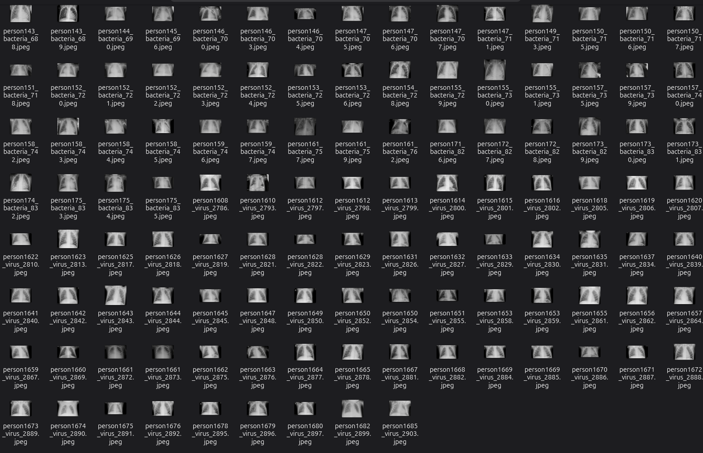

# 🏥 Healthcare Big Data Analytics for Disease Pattern Detection

A Big Data Analytics project that uses **Apache Hadoop, HDFS, MapReduce, Python, and Machine Learning** to analyze healthcare data, identify disease patterns, and generate meaningful visualizations.

## 📌 Project Overview

This project demonstrates how Big Data technologies can be used to process and analyze healthcare datasets.

The system uses Hadoop Distributed File System (HDFS) for metadata storage, MapReduce for distributed data processing, Python for data analysis and visualization, and Machine Learning for chest X-ray classification.

## 🎯 Project Objectives

- Store healthcare metadata using HDFS.
- Process healthcare records using Hadoop MapReduce.
- Analyze Normal and Pneumonia disease categories.
- Identify virus and bacteria categories.
- Divide data into training and testing sets.
- Apply Machine Learning for classification.
- Visualize healthcare analysis results.

## 📂 Dataset

**Dataset:** CoronaHack – Chest X-Ray Dataset  
**Source:** Kaggle

- Contains Normal and Pneumonia chest X-ray records.
- Includes healthcare metadata and image information.
- 5,910 records were used in the project analysis.
- Large dataset files are excluded from this GitHub repository.

## 🛠️ Technologies Used

| Technology | Purpose |
|---|---|
| Python | Data processing and ML |
| Apache Hadoop 3.3.6 | Big Data processing |
| HDFS | Distributed storage |
| Hadoop Streaming | MapReduce execution |
| MapReduce | Data analysis |
| NumPy | Numerical operations |
| Matplotlib | Data visualization |
| Scikit-learn | Machine Learning |
| Pillow | Image processing |

## ⚙️ Project Modules

### 1. Data Storage

Healthcare metadata is stored in Hadoop Distributed File System (HDFS).

### 2. MapReduce Processing

Three MapReduce jobs are implemented:

- Disease category counting.
- Training and testing dataset distribution.
- Virus and bacteria category analysis.

### 3. Data Visualization

Charts are generated to visualize disease distribution, dataset splitting, and virus categories.

### 4. Machine Learning

A HOG-style image feature extraction approach and Logistic Regression classifier are used for chest X-ray classification.

## 📊 Project Results and Analysis

### 1. Disease Distribution

| Disease Category | Number of Records |
|---|---:|
| Normal | 1,576 |
| Pneumonia | 4,334 |
| **Total** | **5,910** |


### 2. Training and Testing Dataset Distribution

| Dataset | Number of Records |
|---|---:|
| Training | 5,286 |
| Testing | 624 |
| **Total** | **5,910** |


### 3. Virus and Bacteria Category Analysis

MapReduce was used to analyze virus and bacteria categories present in the healthcare metadata.


### 4. Machine Learning Results

| Parameter | Result |
|---|---|
| Algorithm | Logistic Regression |
| Feature Extraction | HOG-style features |
| Training Records | 5,286 |
| Testing Records | 624 |
| Accuracy | 78.37% |

#### Confusion Matrix

| Actual / Predicted | Normal | Pneumonia |
|---|---:|---:|
| Normal | 105 | 129 |
| Pneumonia | 6 | 384 |

## 📸 Project Screenshot

### Dataset



## 📁 Project Structure

```text
Healthcare_BigData/
│
├── scripts/
├── processed/
├── output/
│   ├── dataset_split.png
│   ├── disease_distribution.png
│   ├── virus_distribution.png
│   └── healthcare_model.pkl
│
├── screenshots/
├── docs/
├── requirements.txt
├── README.md
└── .gitignore
```

## 🚀 Installation

Clone the repository:

```bash
git clone https://github.com/Swethatongi/Healthcare-BigData-Analytics.git
cd Healthcare-BigData-Analytics
```

Install Python dependencies:

```bash
pip install -r requirements.txt
```

Hadoop 3.3.6 and Java must be configured separately to execute the MapReduce jobs.

The original dataset must also be downloaded separately from Kaggle.

## 🔮 Future Enhancements

- Integrate Apache Hive for SQL-based analysis.
- Improve machine learning classification performance.
- Develop an interactive healthcare analytics dashboard.
- Process larger healthcare datasets.
- Explore advanced machine learning models.

## ⚠️ Disclaimer

This project is developed for academic and educational purposes. Machine Learning predictions are experimental and must not be used for medical diagnosis or clinical decision-making.

## 📝 Conclusion

The project demonstrates the application of Big Data Analytics and Machine Learning in healthcare data analysis through distributed storage, MapReduce processing, disease pattern identification, and visualization.
