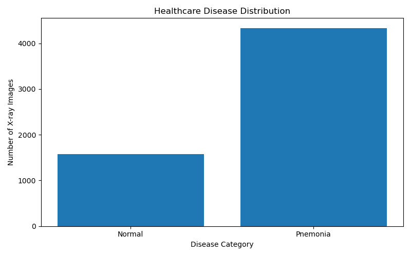
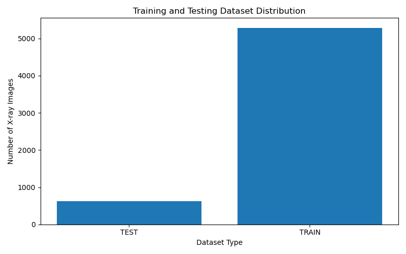
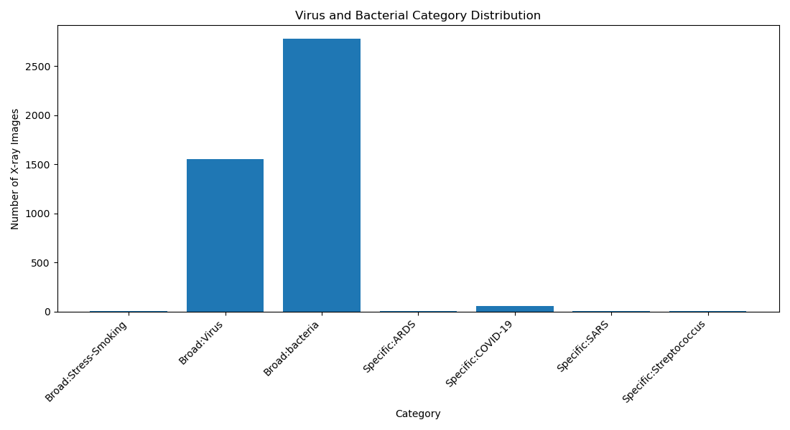

# Healthcare Big Data Analytics for Disease Pattern Detection

## Project Overview
This project uses Big Data Analytics and Machine Learning techniques to analyze chest X-ray images and identify disease patterns in a healthcare dataset.

## Dataset
- Dataset: CoronaHack – Chest X-Ray Dataset (Kaggle)
- Contains Normal and Pneumonia chest X-ray images.
- Includes training and testing data.
- The large dataset files are excluded from this GitHub repository.

## Technologies Used
- Python
- Apache Hadoop 3.3.6
- HDFS
- Hadoop Streaming
- MapReduce
- Hive
- NumPy
- Matplotlib
- Scikit-learn
- Pillow

## Project Modules

### 1. Data Storage
Healthcare metadata is stored in Hadoop Distributed File System (HDFS).

### 2. MapReduce Processing
Three MapReduce jobs are implemented:
- Disease category counting
- Training and testing dataset distribution
- Virus category analysis

### 3. Data Visualization
Charts are generated to visualize:
- Disease distribution
- Dataset split
- Virus categories

### 4. Machine Learning
A HOG-style image feature extraction approach and Logistic Regression classifier are used to classify chest X-ray images.

## Results
- Normal images: 1,576
- Pneumonia images: 4,334
- Training images: 5,286
- Testing images: 624
- Model accuracy: approximately 78.37%

## Folder Structure

```text
Healthcare_BigData/
├── scripts/
├── processed/
├── output/
├── screenshots/
├── docs/
├── requirements.txt
├── README.md
└── .gitignore
```

## Installation

Install the Python dependencies:

```bash
pip install -r requirements.txt
## Project Results and Analysis

### 1. Disease Distribution

| Disease Category | Number of Images |
|---|---:|
| Normal | 1,576 |
| Pneumonia | 4,334 |
| Total | 5,910 |



### 2. Training and Testing Dataset Distribution

| Dataset | Number of Images |
|---|---:|
| Training | 5,286 |
| Testing | 624 |



### 3. Virus Category Analysis

MapReduce was used to analyze virus and bacterial categories.



### 4. Machine Learning Results

- Algorithm: Logistic Regression
- Feature Extraction: HOG-style features
- Training Images: 5,286
- Testing Images: 624
- Accuracy: 78.37%

#### Confusion Matrix

| Actual / Predicted | Normal | Pneumonia |
|---|---:|---:|
| Normal | 105 | 129 |
| Pneumonia | 6 | 384 |

### Conclusion

The project successfully demonstrates healthcare dataset analysis using Hadoop, HDFS, MapReduce, Python visualization, and Machine Learning.

The classification model achieved 78.37% accuracy on the test dataset. This is an educational project and is not intended for clinical diagnosis.```

Hadoop must be installed and configured separately to execute the Hadoop Streaming jobs.

## Important Note
This project is developed for educational purposes. The machine learning model is experimental and is not intended for medical diagnosis or clinical decision-making.
